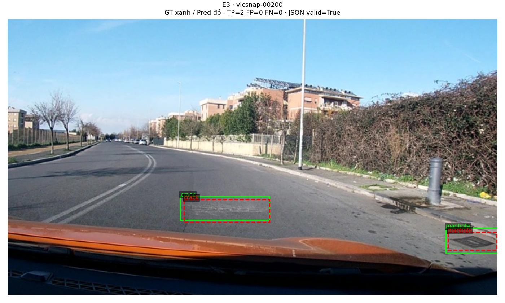
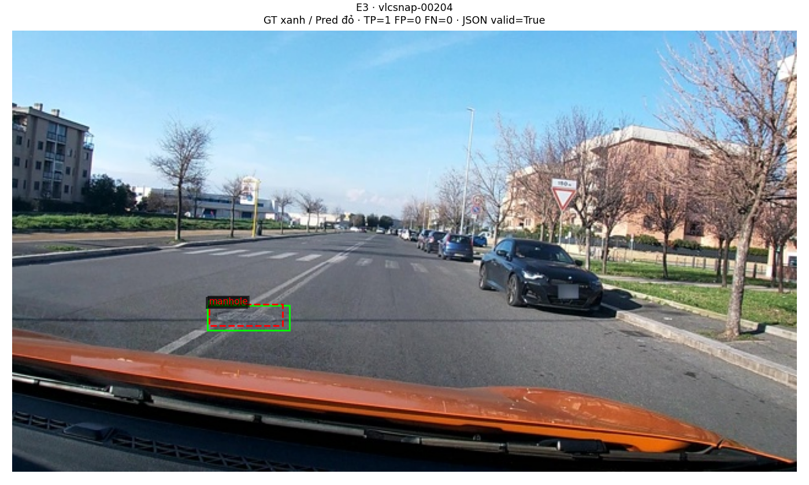
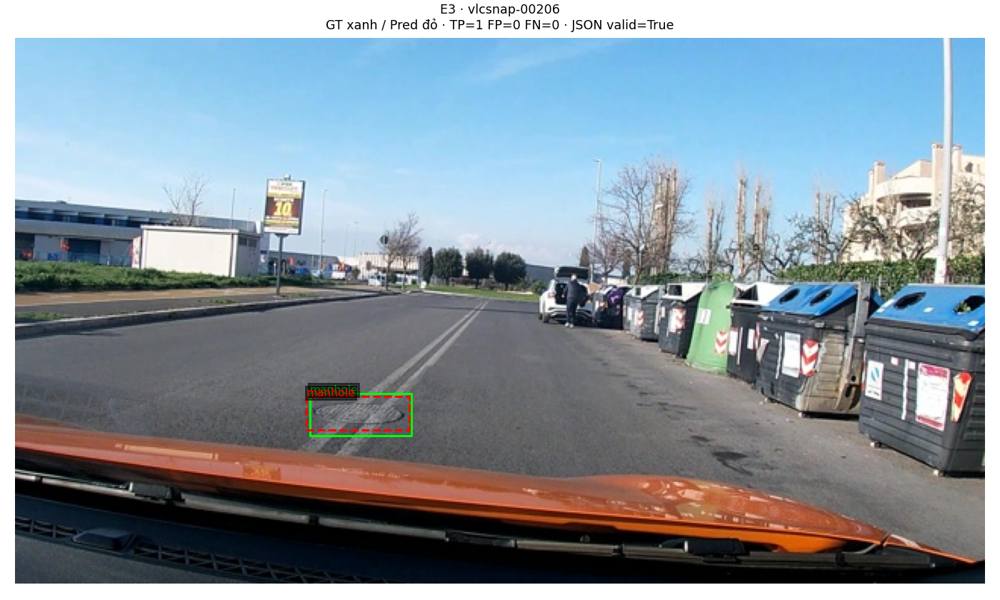
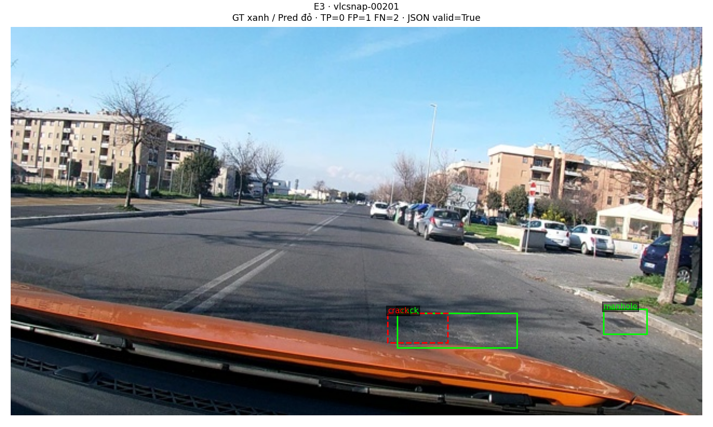
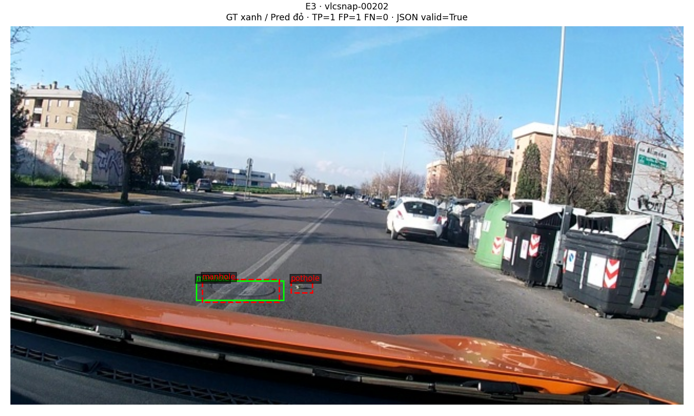
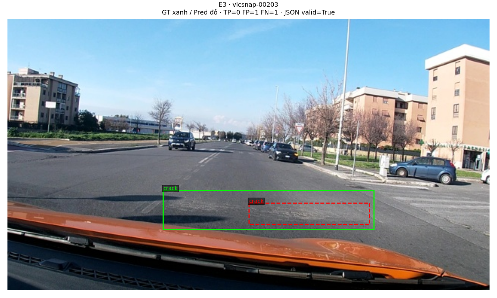

Họ tên: Nguyễn Thái Anh
`dataset_version`: `d10-21e4070301`

# Báo cáo Lab Day 10 — Finetune Qwen3-VL-4B cho hư hại mặt đường

## Thiết lập và nguồn số liệu

Bài dùng `Qwen/Qwen3-VL-4B-Instruct` trên Colab T4, ảnh 640×360 và ba lớp `pothole`, `crack`, `manhole`. LLM dùng NF4 4-bit; toàn bộ `model.visual` và `lm_head` được loại khỏi lượng tử hóa. ViT đóng băng được giữ fp16, các tham số cần cập nhật được chuyển fp32; forward dùng autocast fp16.

Các run E1–E3 dùng 300 bước optimizer thành công, batch 1, tích lũy gradient 8 (effective batch 8), AdamW với learning rate `2e-4`, weight decay 0, warmup 15 bước rồi cosine, gradient clipping 1.0, seed 42. LoRA dùng `r=16`, `alpha=32`, dropout 0.05. Các giá trị batch 1/accumulation 8 là override trong notebook; cấu hình gốc của đề được giữ nguyên.

Dùng 40 ảnh val đầu để gỡ lỗi/chọn baseline E4; chấm đủ 311 ảnh test, `IoU ≥ 0.5`, cùng lớp và ghép một-một theo bộ chấm của đề. Inference dùng batch 4 và `max_new_tokens=256`. Các metrics trong bảng lấy trực tiếp từ [evidence](report/evidence/); thời gian E0 là suy luận, các hàng còn lại là huấn luyện thành công, không bao gồm cài đặt, tải model, toàn bộ inference hay thời gian phiên bị ngắt. VRAM là `torch.cuda.max_memory_allocated()/1024**3` (đơn vị GiB, giữ tên cột GB theo mẫu đề).

Thông tin bổ sung được lưu trong [metadata split](report/dataset_meta.json), [quan sát run/log Colab](report/run_observations.json), [chẩn đoán output E0](report/e0_diagnostics.json) và [lựa chọn E4](report/e4_selection_full.json). Evidence test không bị chỉnh sửa để làm báo cáo.

## Bảng tổng hợp

| Run              |      Params | VRAM GB |  Phút |    F1 | CI95           | FP/ảnh | pothole | crack | manhole |
| ---------------- | ----------: | ------: | ----: | ----: | -------------- | -----: | ------: | ----: | ------: |
| E0               |           0 |    3.77 | 29.43 | 0.075 | [0.050, 0.102] |  0.785 |   0.137 | 0.000 |   0.151 |
| E1               |  33,030,144 |    5.27 | 56.07 | 0.282 | [0.246, 0.325] |  1.100 |   0.167 | 0.215 |   0.538 |
| E2               | 142,135,296 |    6.93 | 57.41 | 0.346 | [0.305, 0.392] |  0.952 |   0.186 | 0.271 |   0.601 |
| E3               | 148,426,752 |    7.06 | 67.33 | 0.453 | [0.409, 0.496] |  0.826 |   0.319 | 0.369 |   0.702 |
| E4_data_size_0.1 | 148,426,752 |    6.70 | 58.38 | 0.289 | [0.256, 0.325] |  1.723 |   0.228 | 0.207 |   0.530 |
| E4_data_size_1.0 | 148,426,752 |    7.06 | 67.33 | 0.453 | [0.409, 0.496] |  0.826 |   0.319 | 0.369 |   0.702 |

E4 100% dùng lại checkpoint và predictions E3: hai file evidence có cùng `run_id`, F1 và CI95. Đây là baseline dùng chung, không phải một lần train E4 100% độc lập.

## 10 câu hỏi

### Câu 1 — Kiến trúc: ViT, projector và LLM có bao nhiêu tham số, mỗi setup cập nhật khối nào?

Log model gốc ghi **4.437.815.808 tham số**. Nhánh `model.visual` có **415.347.712**, bao gồm cả projector; không được cộng thêm projector vào con số này lần nữa. Projector mở ở E2 có **109.105.152** tham số, xác nhận bởi log và hiệu số `142.135.296 − 33.030.144`. Vì vậy ViT backbone không gồm projector có **306.242.560**, còn phần ngôn ngữ và embedding/output dùng chung có **4.022.468.096** (`4.437.815.808 − 415.347.712`). Các phép trừ này là cách phân nhóm từ log, không phải đếm một lần nữa trên model mới.

ViT mã hóa ảnh thành đặc trưng; `visual.merger` và `visual.deepstack_merger_list` chuyển đặc trưng sang chiều của LLM, gồm các nhánh DeepStack. LLM sinh chuỗi JSON chỉ ra lớp và box. [Cấu hình model chính thức](https://huggingface.co/Qwen/Qwen3-VL-4B-Instruct/raw/main/config.json) ghi embedding và output head dùng chung trọng số, nên không cộng `lm_head` như một bộ embedding độc lập.

| Setup | Phần được cập nhật                                     | Tham số trainable |
| ----- | ------------------------------------------------------ | ----------------: |
| E1    | LoRA LLM, 252 module; đóng băng ViT và projector       |        33.030.144 |
| E2    | LoRA LLM như E1 + toàn bộ projector                    |       142.135.296 |
| E3    | E2 + LoRA 96 module attention/MLP ViT; tổng 348 module |       148.426.752 |

LoRA ViT thêm **6.291.456** tham số so với E2. E3 không mở toàn bộ ViT backbone; chỉ các adapter LoRA trong backbone được học. Phần projector full trainable chiếm phần lớn mức tăng từ E1 sang E2.

### Câu 2 — E0: tỷ lệ output hợp lệ và hai lỗi chính của model gốc

E0 có **162/311 output hợp lệ (52,09%)**, **149/311 output không parse được**. Trong 162 output hợp lệ, **59 là `[]`** và 103 có box. Đây là số đếm lại từ predictions đã lưu, được ghi trong [e0_diagnostics.json](report/e0_diagnostics.json).

Hai nhóm lỗi nổi bật:

1. **Output không hoàn tất JSON/lặp nội dung.** Ví dụ `vlcsnap-00202` lặp khóa `bbox_2d`, rồi kết thúc giữa chừng; `parse_output` trả `None`. Ngân sách sinh 256 token là một giới hạn có thể góp vào việc bị cắt, nhưng chưa thử tăng ngân sách để đo riêng tác động. Lặp khóa tự nó không luôn khiến parser JSON Python lỗi; ở ví dụ này cả chuỗi bị dang dở.
2. **Định vị và bỏ sót đối tượng.** Bộ chấm ghi TP=32, FP=244, FN=551; recall chỉ **0,0549**. Riêng `crack` có TP=0, FP=120, FN=299, F1=0. JSON hợp lệ vì thế chưa đảm bảo grounding đúng. Với output `[]`, cần đối chiếu GT mới biết có bỏ sót; không mặc định cả 59 ảnh đều là lỗi.

Ví dụ output thô **hợp lệ** của E0 ở `vlcsnap-00200`:

```json
[
  { "label": "crack", "bbox_2d": [750, 640, 849, 687] },
  { "label": "manhole", "bbox_2d": [750, 640, 849, 687] },
  { "label": "manhole", "bbox_2d": [909, 786, 998, 829] }
]
```

Hai box đầu có cùng tọa độ nhưng khác lớp, minh họa vấn đề dự đoán chồng/lẫn lớp dù chuỗi đúng cấu trúc. Ví dụ không hợp lệ đầy đủ ở `vlcsnap-00202` được lưu trong file chẩn đoán để tránh biến đoạn trích bị cắt thành một output khác.

Sau SFT, tỷ lệ hợp lệ của E1 đạt **309/311 = 99,36%**; E2 và E3 đạt **311/311 = 100%**. F1 E1 tăng từ 0,0745 lên 0,2823, tức **+0,2078**, vượt ngưỡng cải thiện 0,10 của rubric.

### Câu 3 — Thang 0–1000: chấm sai thang ảnh hưởng thế nào và kiểm chứng ra sao?

Tọa độ chuẩn hóa được đổi về pixel bằng `x_pixel=x_norm×640/1000`, `y_pixel=y_norm×360/1000`. Ví dụ box `[430,467,583,506]` thành `[275.2,168.12,373.12,182.16]` pixel. Nếu đưa số norm1000 vào bộ chấm với `coord='pixel'`, bộ chấm lại nhân x với `1000/640` và y với `1000/360`; box bị lệch vị trí/kích thước. Hai trục còn bị đổi theo hai hệ số khác nhau. IoU sẽ giảm hoặc bằng 0 mặc dù JSON vẫn parse được.

Tôi chạy kiểm tra hình học CPU với **9 box JSON đã in trong cell preview mẫu train đầu**, dùng chính `scripts.score.evaluate`. Ground truth tham chiếu được dựng ngược từ các box đã làm tròn; dự đoán của phép kiểm tra được đặt bằng các box đó, không phải output mới của model.

| Dữ liệu dự đoán trong kiểm tra | Thang dùng để chấm |    F1 | TP / FP / FN |
| ------------------------------ | ------------------ | ----: | ------------ |
| Box norm1000                   | norm1000           | 1,000 | 9 / 0 / 0    |
| Cùng box norm1000              | pixel              | 0,000 | 0 / 9 / 9    |
| Box đã đổi đúng sang pixel     | pixel              | 1,000 | 9 / 0 / 0    |
| Cùng box pixel                 | norm1000           | 0,000 | 0 / 9 / 9    |

Cả bốn trường hợp đều có `parse_valid_rate=1.0`: kiểm tra JSON không phát hiện việc dùng sai thang. Mã và kết quả tái chạy được bằng `python report/coordinate_sanity.py`, lưu tại [coordinate_sanity.json](report/coordinate_sanity.json).

Đây là **kiểm tra có kiểm soát trên một mẫu tham chiếu**, không phải F1 của model trên toàn bộ 311 ảnh test khi chấm sai thang. Tôi chưa có phép chấm sai thang đầy đủ trên test; điểm test thực trong bảng đều chấm `norm1000`.

### Câu 4 — Mask loss: vì sao chỉ tính trên phần trả lời?

Mục tiêu là học `P(JSON đáp án | ảnh, prompt)`. Vì vậy các token trước đáp án, gồm prompt và token ảnh, có `labels=-100`; padding cũng là `-100`. Chỉ JSON đáp án và token kết thúc `<|im_end|>` đóng góp cross-entropy. Prompt encoding được kiểm tra là tiền tố của full encoding để vị trí mask không lệch.

Log mẫu xác nhận **220 token ảnh**; batch kiểm tra hai mẫu có `input_ids` và `labels` cùng shape **(2,567)**. Giải mã phần `labels != -100` trả đúng 9 box JSON và `<|im_end|>`. `pixel_values` và `image_grid_thw` được nối theo chiều 0, trong khi token sequence được padding bên phải; inference đổi tokenizer sang padding bên trái.

Nếu tính loss cả prompt/token ảnh, nhiều vị trí dễ đoán và lặp lại của template sẽ chi phối loss, khiến việc giảm loss ít phản ánh chất lượng box. Đặc biệt token ảnh trong chuỗi là vị trí thay bằng đặc trưng thị giác, không phải đáp án cần model học sinh lại. Đó là lý do thiết kế mask; tôi chưa chạy một ablation không mask để gán mức giảm F1 cụ thể.

Log loss đầu/cuối của các run hoàn tất:

| Run | Loss bước 1 | Loss bước 300 | Bước bị bỏ qua do overflow |
| --- | ----------: | ------------: | -------------------------: |
| E1  |      1,1761 |        0,5290 |                          0 |
| E2  |      1,1761 |        0,4551 |                          0 |
| E3  |      1,1761 |        0,4013 |                          0 |

Loss theo batch dao động, nên không mô tả nó giảm đơn điệu. Ba run có xu hướng giảm và các giá trị lưu đều hữu hạn.

### Câu 5 — Lượng tử hóa ViT/projector và lý do dùng float32

Projector nằm bên trong `model.visual`. Nếu lượng tử hóa cả nhánh này, các Linear của merger cũng bị thay bằng `Linear4bit` với trọng số đóng gói; không thể coi các trọng số đó như ma trận float thông thường để mở full training bằng AdamW. Cần giữ projector ở dạng float, hoặc dùng adapter phù hợp thay vì giả định `requires_grad=True` là đủ. Điều này không có nghĩa mọi cách dùng ViT backbone lượng tử hóa đều cấm học một projector float riêng; vấn đề ở cấu hình ban đầu là **chính projector cũng bị lượng tử hóa**.

Tôi đã gặp assertion phát hiện `Linear4bit` trong visual khi skip là `['visual','lm_head']`. Bản sửa dùng **`llm_int8_skip_modules=['model.visual','lm_head']`**, khớp tên module của model trong phiên Transformers đang dùng. Sau load, code kiểm tra visual/lm_head không chứa Linear4bit và LLM vẫn có Linear4bit.

Các tham số trainable của LoRA và projector được chuyển fp32 trước optimizer. FP32 giữ độ chính xác cho cập nhật nhỏ, gradient và trạng thái optimizer, đồng thời phù hợp luồng `GradScaler.unscale_`; không đơn thuần đặt trọng số trainable fp16 rồi hy vọng autocast tự quản lý chúng. Forward vẫn autocast fp16 để giảm bộ nhớ. Đổi projector sang fp32 không loại bỏ mọi nguy cơ overflow, nên code vẫn kiểm tra loss hữu hạn, dùng GradScaler và clipping 1.0.

Projector full trainable có 109.105.152 tham số, riêng trọng số fp32 khoảng **416,2 MiB**, chưa gồm gradient, hai moment của AdamW hay activation. Điều này giải thích phần tăng VRAM E1→E2 từ **5,27 lên 6,93 GB**. Khi lưu E2/E3, adapter LoRA và projector phải lưu riêng; projector nằm ở `extra_trainable.pt` và được kiểm tra key/shape khi nạp lại.

### Câu 6 — Split theo phiên quay và phân bố lớp

Các ảnh là frame video nên nhiều frame cùng phiên rất giống nhau. Chia ngẫu nhiên có thể đưa khung cảnh gần trùng vào cả train và test, giúp model khai thác hình ảnh quen thuộc; F1 khi đó không phản ánh khả năng chuyển sang phiên quay khác. Bộ chia của đề gán cả session vào một split, dùng seed `day10`, salt 0.

Số liệu từ metadata đã xuất và log split:

| Split |   Ảnh | Session | pothole | crack | manhole | Tổng box |
| ----- | ----: | ------: | ------: | ----: | ------: | -------: |
| Train | 1.422 |      13 |   1.074 | 1.750 |     691 |    3.515 |
| Val   |   276 |       2 |      66 |   470 |     103 |      639 |
| Test  |   311 |       3 |     121 |   299 |     163 |      583 |
| Tổng  | 2.009 |      18 |   1.261 | 2.519 |     957 |    4.737 |

Notebook kiểm tra các tập session không giao nhau. `dataset_version=d10-21e4070301` khớp toàn bộ evidence và [metadata đính kèm](report/dataset_meta.json). Tôi không chạy một thí nghiệm chia ngẫu nhiên, nên không báo một mức F1 tăng giả cụ thể. Val chỉ có 66 box pothole, và preview dùng 40/276 ảnh, nên việc chọn setup có độ bất định và không đại diện đầy đủ mọi cảnh.

### Câu 7 — Mở projector và LoRA ViT có đáng không?

E2 tăng F1 từ **0,2823 lên 0,3462** so với E1, chênh **+0,0639**, với thêm **1,66 GB** VRAM và **1,34 phút** train. Chi phí thời gian trong run này nhỏ, nhưng CI95 của E1 `[0,2460;0,3249]` và E2 `[0,3053;0,3919]` còn chồng nhau, nên tôi coi mức cải thiện là tín hiệu cần kiểm chứng thêm thay vì kết luận tuyệt đối.

E3 tăng tiếp lên **0,4530**, chênh E2 **+0,1068**, thêm **0,14 GB** VRAM và **9,92 phút** train. CI95 E3 `[0,4094;0,4959]` không chồng với E2. E3 cũng giảm FP/ảnh từ **0,9518 xuống 0,8264**, và F1 pothole tăng **0,1856→0,3191**, crack **0,2708→0,3691**, manhole **0,6007→0,7020**.

Trong ngân sách T4 của lần chạy này, tôi chọn **E3 khi ưu tiên chất lượng**, vì nó tốt nhất cả trên val preview và test, vẫn dùng khoảng 7,06 GB peak allocated. E1 phù hợp ngân sách bộ nhớ thấp hơn, chỉ 33,03M tham số trainable và 5,27 GB. E2 là mức trung gian; hiệu quả mở projector chưa chắc chắn bằng mức tăng E2→E3. Thời gian và bộ nhớ này là quan sát của một lần chạy/seed, không phải benchmark tốc độ phổ quát.

### Câu 8 — CI95 với 311 ảnh test giới hạn kết luận thế nào?

Bộ chấm bootstrap **1.000 lần theo ảnh**, seed 0. Độ rộng CI95:

| Run    | CI95 F1         | Độ rộng |
| ------ | --------------- | ------: |
| E0     | [0,0499;0,1017] |  0,0517 |
| E1     | [0,2460;0,3249] |  0,0789 |
| E2     | [0,3053;0,3919] |  0,0866 |
| E3     | [0,4094;0,4959] |  0,0865 |
| E4 10% | [0,2558;0,3246] |  0,0688 |

Khoảng E2/E3 rộng khoảng **8,65 điểm phần trăm F1**. Chênh nhỏ giữa hai run vì thế không nên được diễn giải chỉ từ một con số. E1/E2 còn chồng CI; E3/E2 không chồng, là bằng chứng rõ hơn cho mức tăng quan sát được. Tuy nhiên so sánh hai CI biên không thay thế paired bootstrap cho hiệu số F1 trên cùng test; tôi chưa thực hiện phép kiểm định hiệu số đó.

Ngoài kích thước 311 ảnh, test chỉ có **3 session** và các frame trong một session tương quan. Bootstrap theo từng ảnh có thể đánh giá thấp bất định khi chuyển sang phiên quay mới; cần group/cluster bootstrap theo session hoặc nhiều phiên độc lập hơn. Các CI này cũng không đo biến động do train nhiều seed hay lựa chọn model. Vì vậy kết luận chỉ giới hạn ở dataset/split và cấu hình đã chạy.

### Câu 9 — Lớp kém nhất, nguyên nhân và ảnh minh họa

Với setup tốt nhất E3, **pothole kém nhất**, F1 **0,3191**, precision **0,4478**, recall **0,2479**. Nó chỉ có TP=30 trên 121 GT, còn **91 FN** và 37 FP. `crack` đạt F1 0,3691 nhưng đóng góp **187/257 FP** và **189/337 FN**, nên vẫn là nguồn sai số lớn theo số lượng. `manhole` tốt nhất, F1 **0,7020**, TP=106, FP=33, FN=57.

Pothole có ít mẫu train hơn crack (**1.074 so với 1.750**), thường khó phân biệt với mảng tối, bóng hoặc texture đường khi ảnh nhỏ. Crack dài/mảnh có ranh giới box không rõ; box quá hẹp dù đúng lớp có thể không đạt IoU 0,5. Manhole thường có cấu trúc hình dạng rõ hơn. Đây là các giả thuyết phù hợp phân bố và ảnh đã xem; chưa có đo kích thước theo từng lớp hoặc thí nghiệm nhân quả để khẳng định thiếu dữ liệu là nguyên nhân duy nhất. Con số diện tích box trung vị khoảng 0,7% là mô tả dataset trong đề, không phải phép đo lại của tôi.

Sáu ảnh E3 dưới đây dùng GT xanh, dự đoán đỏ nét đứt; TP/FP/FN và JSON validity có trên ảnh. Đây là minh họa chọn sẵn, không phải mẫu ngẫu nhiên đại diện toàn test.

**Ảnh 1 — `vlcsnap-00200`: TP=2, FP=0, FN=0.** Crack và manhole đều được định vị đạt ngưỡng.



**Ảnh 2 — `vlcsnap-00204`: TP=1, FP=0, FN=0.** Nhận diện manhole đúng dù box chưa trùng hoàn toàn.



**Ảnh 3 — `vlcsnap-00206`: TP=1, FP=0, FN=0.** Một ví dụ manhole khác đạt IoU yêu cầu.



**Ảnh 4 — `vlcsnap-00201`: TP=0, FP=1, FN=2.** Box crack quá hẹp không ghép được với GT và manhole bị bỏ sót; JSON vẫn hợp lệ.



**Ảnh 5 — `vlcsnap-00202`: TP=1, FP=1, FN=0.** Manhole đúng, nhưng thêm một pothole không có GT tương ứng. Chưa đủ bằng chứng từ ảnh để kết luận đó chắc chắn là lỗi nhãn.



**Ảnh 6 — `vlcsnap-00203`: TP=0, FP=1, FN=1.** Dự đoán đúng tên crack nhưng chỉ bao một phần vùng GT, không đạt ngưỡng IoU.



### Câu 10 — E4 đổi biến nào và kết luận có đáng tin không?

E4 chỉ đổi **`train_fraction`: 10% so với 100%** trên baseline E3. E3 được chọn từ 40 ảnh val trước khi chạy E4: val F1 E1=0,2951, E2=0,3429, E3=0,5213. Với 1.422 ảnh train, `round(1422×0.1)=142` ảnh được chọn bằng seed 42. LoRA, projector, learning rate, batch/accumulation, số bước 300, prompt, thang tọa độ và cách chấm được giữ như baseline.

| E3 / E4 data_size  | Ảnh train | F1 test | CI95            | FP/ảnh | Phút train |
| ------------------ | --------: | ------: | --------------- | -----: | ---------: |
| 100% (dùng lại E3) |     1.422 |  0,4530 | [0,4094;0,4959] | 0,8264 |      67,33 |
| 10%                |       142 |  0,2890 | [0,2558;0,3246] | 1,7235 |      58,38 |

10% giảm F1 **0,1640** và tăng FP/ảnh khoảng **2,09 lần**. CI không chồng nhau, nên bằng chứng trên test hiện tại cho thấy phần giảm dữ liệu này gây giảm chất lượng rõ. Tuy vậy vẫn chỉ có một subset/seed và ba session test; chưa chứng minh mọi subset 10% đều có mức giảm tương tự.

Log E4 run hoàn tất giảm loss từ **1,2578 ở bước 1** xuống **0,0072 ở bước 300**, nhưng val F1 chỉ **0,3105** và test F1 0,2890. Kết hợp với việc lặp lại một tập nhỏ, đây là dấu hiệu phù hợp với overfitting. 300 bước × 8 ảnh/bước tương ứng khoảng 2.400 lượt ảnh ở các bước thành công: khoảng 16,9 lượt/ảnh cho tập 142 ảnh so với 1,69 lượt/ảnh ở 1.422 ảnh. Tôi không dùng training loss thấp làm bằng chứng rằng model tốt hơn.

10% không có nghĩa train chỉ tốn 10% thời gian: cả hai dùng 300 bước. Thời gian đo được là 58,38 và 67,33 phút; không dùng chúng để suy ra tốc độ tuyến tính theo data_size. E4 100% giữ nguyên `run_id` của E3, không được xem như thêm một replicate độc lập.

## Nhìn lại

Quota Colab làm run E4 ban đầu dừng sau checkpoint bước 100. Run tạo evidence cuối được train lại từ bước 0 bằng cell độc lập và giữ nguyên artifacts E0–E3. Checkpoint hiện không lưu optimizer/scheduler/scaler/RNG nên không gọi quá trình này là resume chính xác. Thời gian trong evidence E4 chỉ thuộc run hoàn tất, không cộng thời gian run bị ngắt.

Một giới hạn tái lập khác là các run lưu `model_revision='main'`, chưa có immutable commit hash; fingerprint giúp kiểm tra cấu hình nhưng không đảm bảo model trên upstream không thay đổi. Muốn tái lập nghiêm ngặt cần khóa revision trước một lần chạy mới, không sửa revision/fingerprint của evidence đã chạy.

Báo cáo tách số đo thật khỏi kiểm tra hình học và nhận định lý thuyết: chưa đo full-test sai thang, chưa chạy loss không mask, random split, nhiều seed hay cluster bootstrap. Các hướng này hữu ích hơn việc chỉ tiếp tục giảm training loss. Danh sách lỗi, cách xử lý và phần kiểm tra còn lại nằm trong [BAO_CAO_LOI_VA_LUU_Y.md](BAO_CAO_LOI_VA_LUU_Y.md).
